  

  
  
  
  

 

  

 

  

 

  

  <picture>
    <source media="(prefers-color-scheme: dark)" srcset="https://raw.githubusercontent.com/abdallahabusidu/abdallahabusidu/output/snake-dark.svg" />
    
  </picture>

<code>// no bugs were harmed in the making of this profile. ok, a few.</code>

